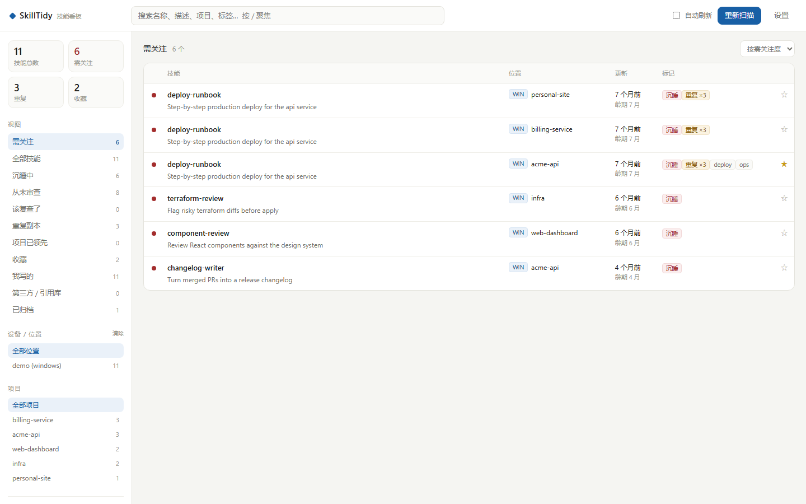

# SkillTidy

**Tidy up the agent skills you wrote.**

`apm` and `asm` get skills *installed*. SkillTidy deals with what happens afterwards:
the skill you wrote six months ago, forked into three worktrees, half-superseded by a
change in the repo, and never opened again.

- Scans every `SKILL.md` across **Windows, macOS, Linux and WSL**, in one list
- Flags **stale** (untouched for months), **duplicated** (same skill, many copies),
  **drifted** (the project moved on, the skill didn't), **never reviewed**
- Local dashboard on `127.0.0.1` — read, edit, tag, archive, mark as reviewed
- **Zero dependencies.** No telemetry, no network calls, read-only by default



```
  SkillTidy - 11 skills  (0.2s, 1 root)
  6 stale   0 due for review   3 duplicated   0 vendor   8 never reviewed

NAME                          AGE      STATE        SCOPE    PROJECT                OS
deploy-runbook                214d     stale        project  acme-api               windows
terraform-review              189d     stale        project  infra                  windows
component-review              165d     stale        project  web-dashboard          windows
```

## Quick start

```bash
npx skilltidy init     # find skill folders on this machine, write ~/.skilltidy/config.json
npx skilltidy scan     # what do I actually have?
npx skilltidy ui       # open the dashboard at http://127.0.0.1:7788
```

Or install it once:

```bash
npm i -g skilltidy
skilltidy ui
```

Requires Node 18+. There is nothing to compile and nothing to configure by hand —
`init` looks for `.claude/skills`, `.codex/skills`, `.agents/skills`,
`.workbuddy/skills`, `.codebuddy/skills` and the usual project folders, on the host
and inside every WSL distro.

## Commands

| Command | What it does |
|---|---|
| `skilltidy init` | Detect scan roots, write the config. `--force` to redo. |
| `skilltidy scan` | List skills ordered by how much attention they need. `--json`, `--limit n` |
| `skilltidy check` | CI gate. Exits 1 when the rules you name are violated. |
| `skilltidy ui` | Local dashboard. `--port n`, `--no-open` |
| `skilltidy open <name>` | Reveal a skill folder in Explorer / Finder / xdg-open |

## What the states mean

| Flag | Meaning | Default |
|---|---|---|
| `stale` | `SKILL.md` untouched for longer than `staleDays` | 90 days |
| `due` | You confirmed it `reviewDays` ago, time to look again | 45 days |
| `unreviewed` | Never marked as reviewed — the initial state of everything | — |
| `dup` | Other skills share the same name (possibly different content) | — |
| `drift` | The project has commits newer than the skill | > 7 days |

"Mark as reviewed" is the load-bearing action. It changes no files — it records that
you looked at the skill and decided it is still correct. Without it every list turns
into a wall of red and you stop reading it.

## Why not just use `asm` / `apm` / a registry?

They solve distribution: getting a skill from a repo into `.claude/skills`.

SkillTidy solves hygiene: noticing that you have 131 duplicates, that 123 skills have
not been touched in a year, and that the repo changed after you wrote the instructions.
They compose fine — SkillTidy only reads what is on disk.

There are already a few local dashboards that *list* your skills. The gaps they leave
are the two this project was built around:

- **Nothing crosses the WSL boundary.** Your skills are usually half on Windows, half
  inside a distro, in repos that no host-side scanner will ever walk.
- **Nothing tracks time.** Listing skills is easy; knowing which ones rotted, which
  copies are stale forks in a worktree, and which you already reviewed is the part
  that decides whether the list stays useful after week one.

## Multi-device

The dashboard is per-machine; your annotations are portable.

```bash
skilltidy ui           # settings → Export notes   (on machine A)
skilltidy ui           # settings → Import notes   (on machine B)
```

Merging is field-wise: newest review wins, tags union, longer note wins, star is OR.

If you prefer syncing the whole state folder (`~/.skilltidy`), keep it in a private
repo — it is just `config.json`, `meta.json` and a cache. Skill ids are derived from
`root id + path relative to that root`, so the same skill keeps its id on another
machine as long as the root is named the same.

## Configuration

`~/.skilltidy/config.json` (override the folder with `SKILLTIDY_HOME`):

```json
{
  "staleDays": 90,
  "reviewDays": 45,
  "roots": [
    {
      "id": "wsl-pros",
      "label": "WSL - projects",
      "path": "\\\\wsl.localhost\\Ubuntu\\home\\you\\pros",
      "device": "WSL Ubuntu",
      "scope": "project",
      "kind": "mine",
      "enabled": true,
      "maxDepth": 8
    }
  ],
  "skipDirs": [".git", "node_modules", "cache", ".tmp"],
  "vendorPatterns": ["/node_modules/", "/.claude/plugins/marketplaces/"]
}
```

- `scope: global` — a tool-level skills folder; the dashboard shows it as "global"
- `scope: project` — a folder of repos; each skill is attributed to the repo it sits in
- `kind: vendor` — third-party collections, greyed out and filterable
- `skipDirs` — plugin caches. Skipping these matters: one `.codex/.tmp/plugins` folder
  can contain 600 skills and drown the list
- `vendorPatterns` — path fragments marking a skill as third-party

See `examples/` for macOS, Linux and Windows+WSL starting points.

## How the scanning works

Two adapters, chosen by path shape:

- **fs adapter** — normal `readdir` walk for Windows / macOS / Linux. Stops descending as
  soon as it finds a `SKILL.md`.
- **WSL adapter** — for `\\wsl.localhost\...` paths. Walks *inside* the distro with a
  native `find`, because recursive traversal over the 9p UNC mount is about 90x slower
  (89s vs 1s on a mid-size repo). The script is passed as base64: `wsl.exe` mangles
  `$variables` and single quotes in forwarded command lines.

Git drift uses `git -C <project> log -1`. It is skipped for WSL by default
(`git.wsl: false`) so scanning never wakes a stopped distro.

## In CI

```yaml
- run: npx skilltidy check --fail-on stale,dup --days 120
```

Useful in a repo that ships its own skills: fail the build when they rot.

## Non-goals

Not a package manager, not a registry, not a desktop app, not a SaaS.
It reads what other tools wrote and tells you the truth about it.

## 中文速览

`apm`/`asm` 管技能怎么装，SkillTidy 管技能有没有烂在那儿。

```bash
npx skilltidy init   # 自动探测本机与 WSL 里的技能目录
npx skilltidy scan   # 看看自己到底写了多少
npx skilltidy ui     # 打开看板 http://127.0.0.1:7788
```

零依赖、不联网、默认只读。星标/标签/备注/审查记录存在 `~/.skilltidy/meta.json`，
可以跨设备导出导入。详见 `examples/config.windows-wsl.json`。

## License

MIT
