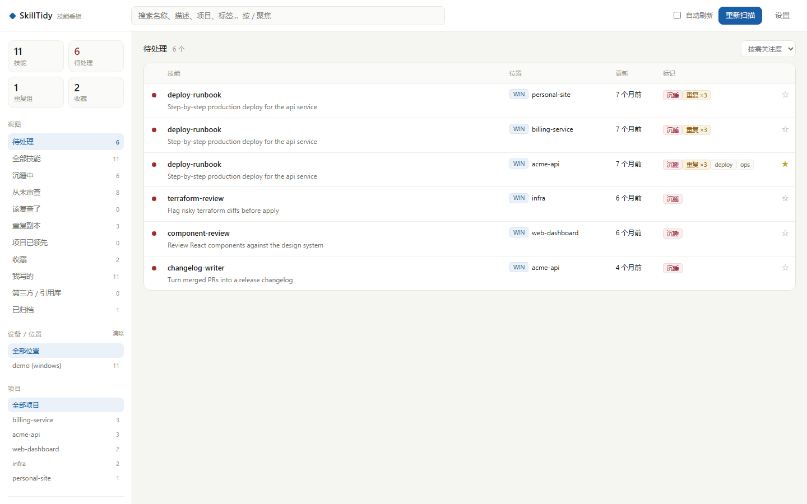

# SkillTidy

[English](README.md) | **简体中文**

**知道哪些技能还成立，哪些你已经确认过。**

`apm` 和 `asm` 解决的是技能怎么*装进去*。装完就没人管了：六个月前写的那个技能，被 fork 到三个 worktree 里，描述的命令行早就改过名。

SkillTidy 只回答两个问题，其余一概不管：

- **哪一份才是正本？** 同一个技能散落在五个仓库里，其中三个是 worktree 留下的残骸。
- **我上次确认它还成立是什么时候？** 这份记录只有你能维护。

剩下的都是推论：它数 **drift**（技能最后一次改动之后，仓库又提交了多少次），而不是拿文件年龄去猜；它把 **Windows 和 WSL 放在同一个列表**里；它把你的确认记在本地账本上。零依赖、不联网、默认只读。



```
  SkillTidy - 9 skills  (0.3s, 1 root)
  7 need a decision   3 confirmed   6 never confirmed
  7 drifted   9 untouched 90d+   0 vendor

NAME                STATE       CONFIRMED  UPDATED  SCOPE    PROJECT
deploy-runbook      drift +31   never      238d     project  personal-site
terraform-review    drift +18   never      95d      project  infra
api-conventions     ok          6d ago     238d     project  acme-api
```

## 快速开始

```bash
npx skilltidy init     # 找到本机的技能目录，写入 ~/.skilltidy/config.json
npx skilltidy scan     # 我到底写了多少？
npx skilltidy ui       # 打开看板 http://127.0.0.1:7788
```

或者装一次：

```bash
npm i -g skilltidy
skilltidy ui
```

需要 Node 18+。没有编译步骤，也不需要手写配置——`init` 会去找 `.claude/skills`、`.codex/skills`、`.agents/skills`、`.workbuddy/skills`、`.codebuddy/skills` 以及常见的项目目录，主机和每个 WSL 发行版里都扫一遍。

## 命令

| 命令 | 作用 |
|---|---|
| `skilltidy init` | 探测扫描位置并写配置。`--force` 重做。 |
| `skilltidy scan` | 按需要关注的程度列出技能。`--json`、`--limit n`、`--all` |
| `skilltidy check` | CI 门禁。命中你指定的规则时退出码 1。 |
| `skilltidy ui` | 本地看板。`--port n`、`--no-open` |
| `skilltidy open <名字>` | 在资源管理器 / Finder / xdg-open 里打开技能目录 |
| `skilltidy disable <名字>` | 停用：让 agent 不再加载它（见下文） |
| `skilltidy enable <名字>` | 恢复启用 |
| `skilltidy tag <名字> --add a,b` | 加/删标签。`--list` 看标签分布 |

## 状态的含义

| 标记 | 含义 | 默认值 |
|---|---|---|
| `drift` | 技能最后一次改动之后，仓库又提交了 N 次 | ≥ 10 次提交 |
| `dup` | 有别的技能同名（内容可能不同） | — |
| `due` | 你在 `reviewDays` 天前确认过，该再看一眼 | 45 天 |
| `stale` | `SKILL.md` 超过 `staleDays` 没动 —— 只是信息，不是问题 | 90 天 |
| `never` | 从没确认过。所有技能的初始状态 | — |
| `off` | 已停用：清单被改名，agent 跳过它，不再要求你关注 | — |

只有 `drift` 和 `dup` 算**待决策**：这两种情况工具能拿出证据说明它可能不对。「你还没看过这个」是记账，不是发现。

「确认仍然成立」是整个工具的核心动作。它不写任何文件——只记录你看过了、判断它现在依然正确。并且**确认时间晚于仓库最新提交时，drift 就算解决**：那一刻你看的就是当前代码。

## 停用一个技能

这个工具里只有一个动作会改你的文件，就是改名：

```
SKILL.md  ->  SKILL.md.disabled
```

实现就这么一行。agent 工具找的是名叫 `SKILL.md` 的文件，改完名它就不再加载。什么都没搬走，什么都没编辑，内容一个字节没动——同样的字节还在，只是换了个 agent 不认的名字。改回来就是完整的撤销，`skilltidy enable` 干的就是这件事。

为什么用改名而不是在 `meta.json` 里记一个标记：标记只会让看板*看起来*停了，agent 照样在加载。如果目的是让它不可用，那就得让文件本身变。

三个需要知道的后果：

- **看板仍然列着它。** 扫描会同时找两个名字，所以停用的技能留在「已停用」视图里，标签、备注、确认记录都在。看不见的技能，你就没办法再把它打开。
- **git 会看到这次变更。** 如果技能放在仓库里，改名是一次普通的文件变更（一次删除加一次新增）。想让停用状态跟着仓库走就提交它；只想本地生效，就把 `*.disabled` 加进 `.gitignore`。
- **停用的技能退出所有规则。** 不算 drift、不算重复、不算陈旧，也不会让 `check --fail-on` 失败。这个问题你已经回答过了，它不会再问。

## 标签

标签存在 `~/.skilltidy/meta.json`，从不写进你的技能文件，所以加标签没有成本，并且能跟着其余状态在设备之间同步。技能 frontmatter 里的 `tags:` 也会显示——合并、去重——但它是只读的，因为它属于文件。

看板侧边栏有标签列表（点一下筛选，可以和视图、项目叠加），抽屉里可以一键复用已有标签，免得最后出现 `backend`、`Backend`、`后端` 三个同义标签。命令行也能批量处理：

```bash
skilltidy tag deploy-runbook --add deploy,ops
skilltidy tag "diagnose" --remove temp
skilltidy tag --list
```

## drift 是怎么算的

drift 是提交次数，不是年龄。对每个技能，SkillTidy 找到最后一次改动它所在目录的提交，再数这个仓库此后又落了多少次提交：

```
diagnose  ->  技能最后一次改动之后，仓库又提交了 1294 次
```

一个一年没动、但描述的流程压根没变的技能，没问题。一个上周刚改、却指向一个已改名的参数的技能，有问题。数提交是唯一便宜到能天天跑、又能把这两种情况分开的信号。

开销：每个仓库一次 `rev-list`，加上每个技能目录一次 `git log -1`，所以历史再大也不贵。在 WSL 上整个循环在发行版内部跑，只调一次 `wsl.exe`。以下情况跳过 drift：worktree（历史是重复的）、第三方包（别人的仓库），以及找不到可用的 git 可执行文件时——`SKILLTIDY_DEBUG=1` 会打印最终选中了哪个。

## 为什么不直接用 `asm` / `apm` / 某个注册中心？

它们解决分发：把技能从仓库装进 `.claude/skills`。

SkillTidy 解决卫生：发现你有 131 个重复副本、123 个技能一年没人碰、以及你写完说明之后仓库又改了。两者不冲突——SkillTidy 只读磁盘上已有的东西。

市面上已经有一些本地看板，能*列出*你的技能。它们留了两个缺口，这个项目就是围着这两个缺口做的：

- **没有东西跨过 WSL 边界。** 你的技能通常一半在 Windows、一半在发行版里的仓库中，主机侧的扫描器永远走不到那些地方。也就是说，「这是同一个技能散在三处」这句话，别人说不出来。
- **没有东西知道你上次看它是什么时候。** 列出技能很容易；难的是技能只会相对于现实而腐化。SkillTidy 保存了唯一一份任何 linter 都生成不了的数据——你的确认——并把它和提交历史对照。

## 多设备

看板是每台机器各自一份；你的标注是可携带的。

```bash
skilltidy ui           # 设置 → 导出笔记   （在机器 A 上）
skilltidy ui           # 设置 → 导入笔记   （在机器 B 上）
```

合并是按字段的：确认时间取较新、标签取并集、备注取较长、星标取或。

如果你更想直接同步整个状态目录（`~/.skilltidy`），把它放进一个私有仓库就行——里面只有 `config.json`、`meta.json` 和一份缓存。技能 id 由 `根 id + 相对该根的路径` 算出，所以只要根的名字一致，同一个技能在另一台机器上会保持同一个 id。

## 配置

`~/.skilltidy/config.json`（用 `SKILLTIDY_HOME` 改目录）：

```json
{
  "staleDays": 90,
  "reviewDays": 45,
  "driftCommits": 10,
  "git": { "enabled": true, "wsl": true },
  "roots": [
    {
      "id": "wsl-pros",
      "label": "WSL - 项目",
      "path": "\\\\wsl.localhost\\Ubuntu\\home\\you\\pros",
      "device": "WSL Ubuntu",
      "scope": "project",
      "kind": "mine",
      "enabled": true,
      "maxDepth": 8
    }
  ],
  "skipDirs": [".git", "node_modules", "cache", ".tmp"],
  "vendorPatterns": ["/node_modules/", "/.claude/plugins/marketplaces/"]
}
```

- `scope: global`——工具级的技能目录；看板里显示为「全局」
- `scope: project`——一个装着多个仓库的目录；每个技能归到它所在的仓库
- `kind: vendor`——第三方合集，置灰并可以单独筛选
- `skipDirs`——插件缓存。跳过它们很关键：一个 `.codex/.tmp/plugins` 目录里可能有 600 个技能，能把列表淹掉
- `vendorPatterns`——路径片段，命中即标记为第三方
- `driftCommits`——技能最后一次改动之后累计多少次提交算 drift
- `git.wsl`——不想在发行版里调 git 就设成 `false`

macOS、Linux、Windows+WSL 的起手配置见 `examples/`。

## 扫描是怎么做的

两个适配器，按路径形态选择：

- **fs 适配器**——普通 `readdir` 遍历，用于 Windows / macOS / Linux。一旦发现 `SKILL.md` 就停止向下递归。
- **WSL 适配器**——用于 `\\wsl.localhost\...` 这类路径。在发行版*内部*用原生 `find` 遍历，因为在 9p UNC 挂载上递归遍历慢大约 90 倍（中等规模的仓库：89 秒 vs 1 秒）。脚本以 base64 传入：`wsl.exe` 会篡改转发的命令行里的 `$变量` 和单引号。

git 的定位方式是探测 `where`/`which` 的输出，取第一个真的能打印版本的二进制：有些机器上裸名字会命中一个静默退出的 shim，那会让所有 drift 悄悄变成 0。

## 用在 CI 里

```yaml
- run: npx skilltidy check --fail-on drift --drift-commits 25
```

适合自带技能的仓库：当代码已经走得太远、说明大概率已经不对时，让构建失败。

## 非目标

不是包管理器，不是注册中心，不是桌面应用，不是 SaaS。它读别的工具写下的东西，然后告诉你实情——只有一个刻意的例外：`disable` / `enable` 会重命名清单文件，因为「让 agent 别加载它」没法靠读来实现。

## License

MIT
